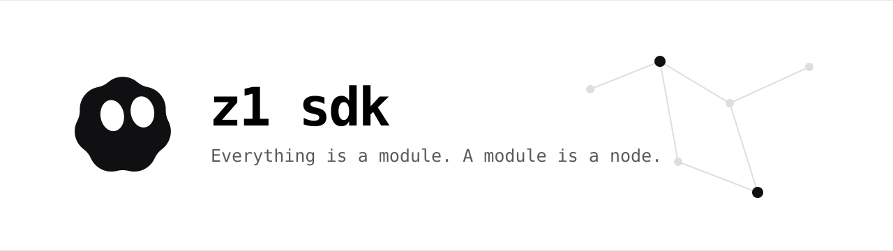

<p align="center">
  <picture>
    <source media="(prefers-color-scheme: dark)" srcset="assets/banner-night.svg">
    
  </picture>
</p>

<p align="center">
  <a href="LICENSE"></a>
  
  
  
</p>

<p align="center">
  <strong>A modular agent SDK where everything is a node.</strong><br>
  Journaled graph runtime · branch memory · sandboxed modules · headless server · canvas
</p>

---

## What is z1?

z1 is an agent runtime built as a **graph of executable nodes** instead of a chat
loop. A model provider, a tool call, filesystem access, the prompt itself, and the
agent loop are all modules with declared inputs and outputs. A workflow is
assembled, not prompted.

The runtime is small and durable: every node execution is a checkpoint in an
append-only journal, a run can resume after a crash, a fork is a pointer rather
than a copy, and approvals are data on the node rather than a global switch.

```
chat / CLI / canvas
        │
        ▼
   graph template ──► executor ──► nodes
                                      │
                    journal ◄─────────┤
                    branches ◄────────┤
                    services ◄────────┘ (llm · fs · tools)
                                      │
                                      ▼
                               worker modules
```

## Why

- **Everything is a module.** Nodes, services, providers and graph templates are
  packages with manifests. Third-party code is installed with an explicit grant,
  runs in a child process, and reports every capability call back to the host.
- **A graph run is the primitive.** The agent loop is a graph you can read, diff
  and fork — not hidden control flow.
- **The prompt is a graph.** Sections are nodes, the stack is a node, and the
  rendered hash is journaled, so the prompt behind any branch is reproducible.
- **Memory is the run tree.** Ancestors, siblings and recent steps become a
  context envelope; a sibling records what was tried, not what is true.
- **Approvals are per node.** `auto`, `ask`, `deny`, with runtime escalation as a
  separate decision. A paused run is persisted, not a parked process.

## Architecture

```text
chat / CLI / canvas
  → graph template
    → executor
      → nodes
        ├── run journal      append-only, resume, fork
        ├── branch memory    ancestors, siblings, recent steps
        └── services         llm · fs · tools
              └── worker module → capability broker → nodes
```

The executor is the only component that schedules work. Everything it touches —
a node, a service, a provider, a prompt section, a graph template — is resolved
from a module or a config entry, never imported by the CLI directly.

## Quick start

Requires **Node.js 24.9+** and **pnpm 11**.

```bash
pnpm install
pnpm -C z1 build                 # typecheck every package
pnpm -C z1 test                  # 690 tests

# run the agent loop with the deterministic mock model
pnpm z1 run --template agent.loop --message '[[tool:echo]] hi'

# canvas from one process
pnpm z1:canvas:build
pnpm z1 studio
```

## Providers

z1 talks to any OpenAI-compatible `/chat/completions` endpoint. A run selects a
model as `--model <provider>/<model>`; without `--live` it uses the mock.

```bash
# OpenAI
export OPENAI_API_KEY=sk-...
pnpm z1 run --template agent.loop --live \
  --model openai/gpt-4.1-mini --message 'hello'

# a local server (Ollama, vLLM, LM Studio): override the base URL
export OPENAI_API_KEY=local
export Z1_OPENAI_BASE_URL=http://127.0.0.1:11434/v1
pnpm z1 run --template agent.loop --live \
  --model openai/qwen3 --message 'hello'

# River is just another OpenAI-compatible endpoint
export RIVER_API_KEY=...
pnpm z1 run --template agent.loop --live \
  --model river/deepseek-ai/DeepSeek-V4.1-Flash --message 'hello'
```

The model string is passed through, so use any model your key can access. A new
provider is data, not code — add it to `z1.config.json`:

```json
{
  "providers": [
    {
      "id": "local",
      "envKey": "LOCAL_API_KEY",
      "baseURL": "http://127.0.0.1:11434/v1"
    }
  ]
}
```

then run with `--model local/qwen3`. `Z1_<ID>_BASE_URL` overrides a provider's
base URL. Rate limits are retried with backoff; tune the budget with
`Z1_LLM_RETRY_ATTEMPTS`, `Z1_LLM_RETRY_BASE_MS` and `Z1_LLM_RETRY_MAX_MS`.

## Commands

| Command | What it does |
| --- | --- |
| `z1 run --template <id>` | run a graph template without a graph file |
| `z1 run <graph.json>` | run a graph document |
| `z1 tree` / `z1 fork` | inspect the run tree, fork a branch |
| `z1 memory context <run>` | print the branch-tree context envelope |
| `z1 module propose/approve/list` | review and install executable modules |
| `z1 serve` | headless WebSocket server |
| `z1 studio` | server + built canvas in one process |

## The node contract

```ts
export const chat = defineNode({
  id: 'z1.llm.chat',
  version: '1.0.0',
  category: 'llm',
  config: z.object({ system: z.string().optional() }),
  inputs: [
    dataPort('messages', z.array(messageSchema)),
    flowPort('in', { required: false }),
  ],
  outputs: [dataPort('text', z.string()), flowPort('out')],
  async execute(ctx) {
    const result = await ctx.llm.chat(
      { model: ctx.config.model, messages: ctx.inputs.messages },
      (delta) => ctx.emit('text', delta.text),
    )
    return { text: result.message.content, out: true }
  },
})
```

Data ports are pulled from cache; flow edges order side effects. Cycles live only
inside `flow.loop`, `flow.map` or a subgraph. Nested runs carry an iteration label,
so a fork inside a loop replays only the earlier iterations.

## What is in the repo

| Path | Contents |
| --- | --- |
| `z1/packages/node`, `graph`, `runtime` | the kernel: contract, document, executor |
| `z1/packages/nodes` | core, flow, llm, tool and prompt nodes |
| `z1/packages/prompt` | sections, role presets, stacking and hashing |
| `z1/packages/journal` | SQLite run journal, forks, blobs |
| `z1/packages/memory`, `agent` | branch context and the agent loop as a graph |
| `z1/packages/module`, `node-host` | executable modules and the worker sandbox |
| `z1/packages/provider`, `template`, `bootstrap` | providers, templates, one runtime |
| `z1/packages/protocol`, `server` | JSON-RPC over WebSocket and the headless server |
| `z1/apps/cli`, `canvas` | the `z1` command and the React Flow canvas |
| `packages/*`, `apps/*` | the upstream DeepSeek Harness engine |

## Status

**Early.** The graph engine, journal, resume, approvals, forks, prompt nodes,
sandboxed modules, server and canvas are implemented and tested (690 tests). The
upstream engine still builds with its 10 gates.

Not in this repository:

- **concrete tools** — they live in a separate `z1-tools` package/repository; the
  SDK keeps only the tools service contract and brokered capabilities;
- **editor integration** — the canvas is a standalone app for now;
- **OS-level sandboxing** for untrusted modules — Node's permission model is not
  a network boundary, which is documented in `z1/packages/node-host/README.md`.

## Documentation

- [`z1/SPEC.md`](z1/SPEC.md) — node, graph, executor, journal and module contracts
- [`z1/TASKS.md`](z1/TASKS.md) — what was built, milestone by milestone
- [`z1/README.md`](z1/README.md) — service modules and the trust boundary
- [`NOTICE.md`](NOTICE.md) — fork provenance and what changed upstream

## Licence

MIT. z1 additions are Copyright (c) 2026 z1 contributors; the upstream
DeepSeek Harness notice is retained in [LICENSE](LICENSE). Third-party
components are listed in [THIRD_PARTY_NOTICES.md](THIRD_PARTY_NOTICES.md), and
the fork is described in [NOTICE.md](NOTICE.md).
